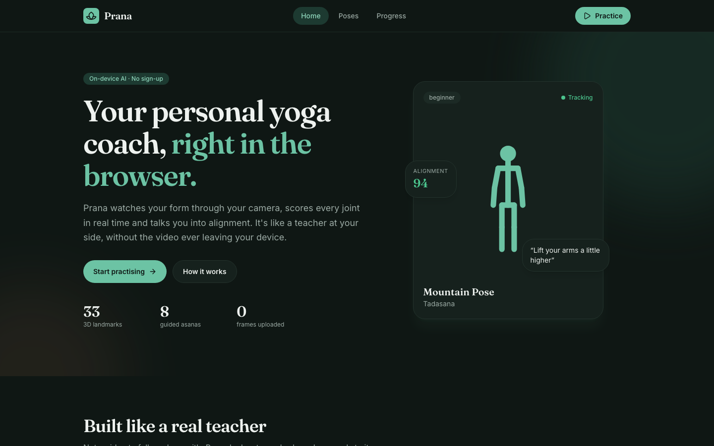
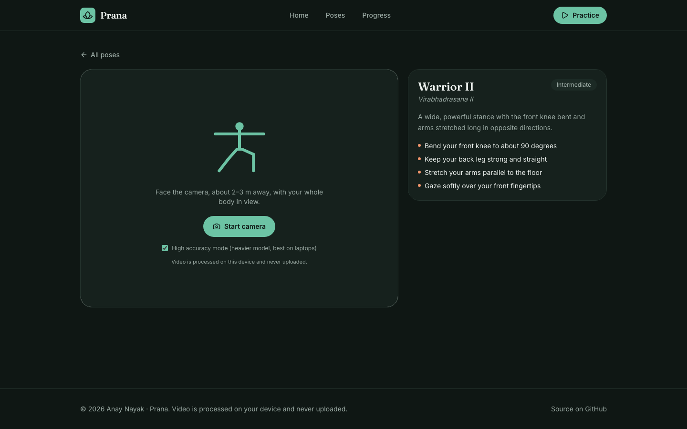
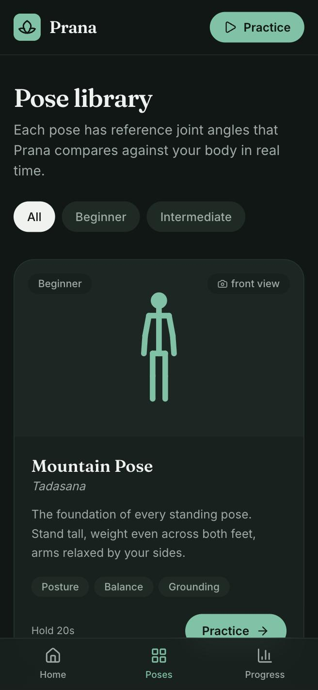
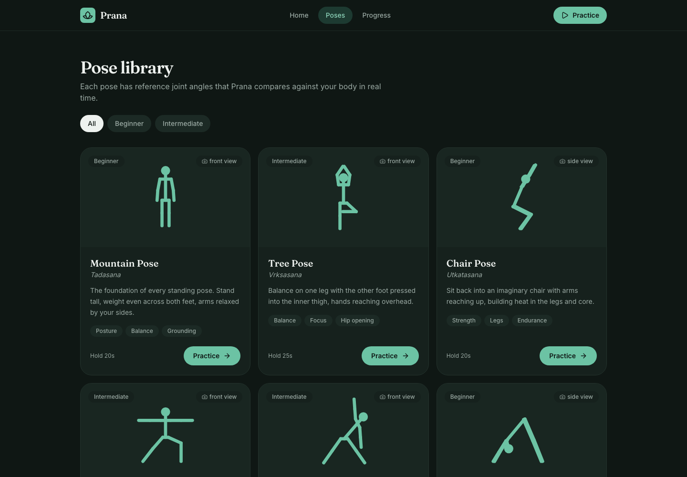
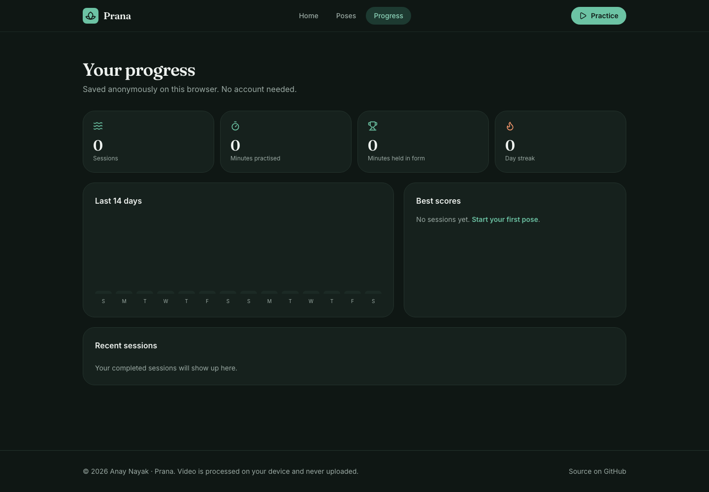
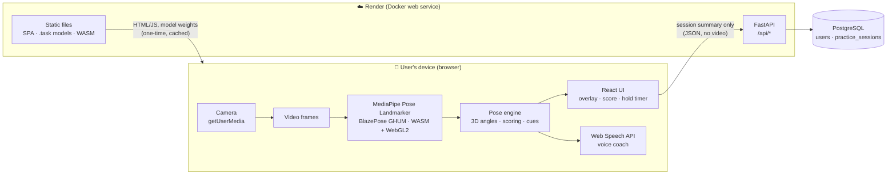
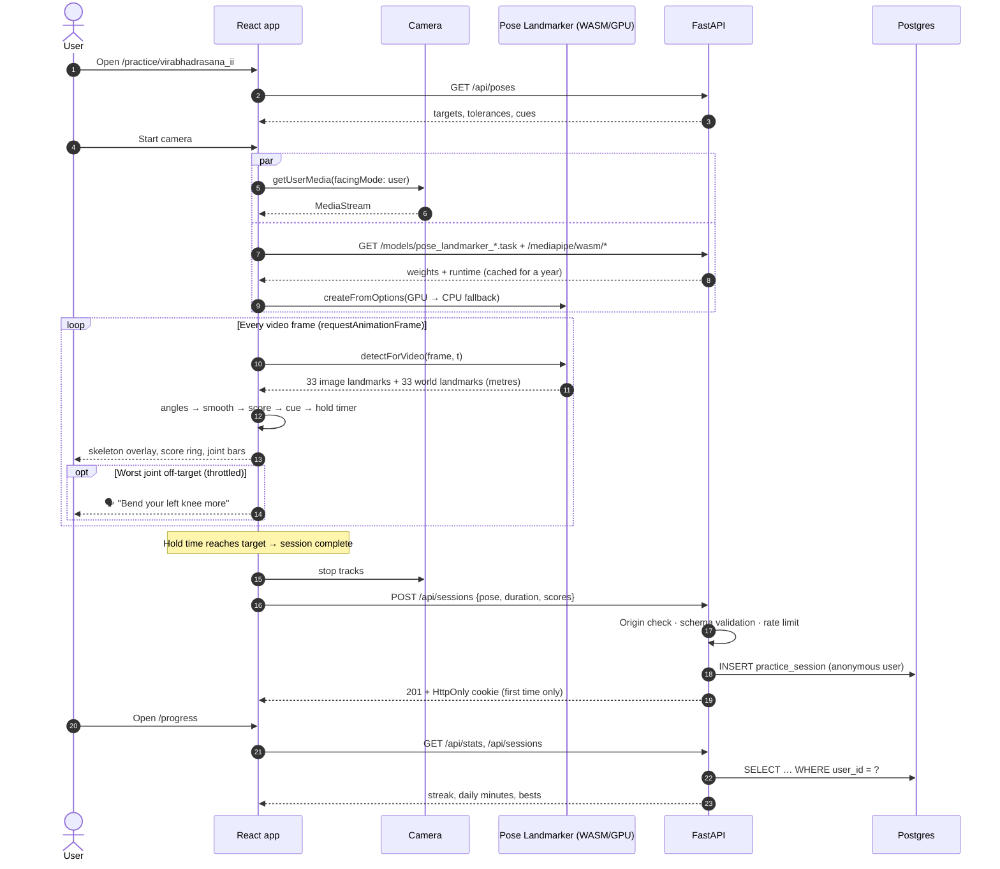
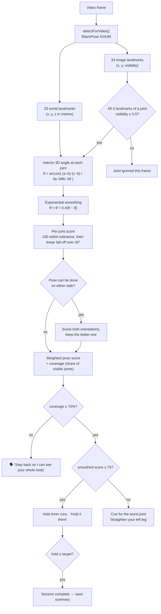
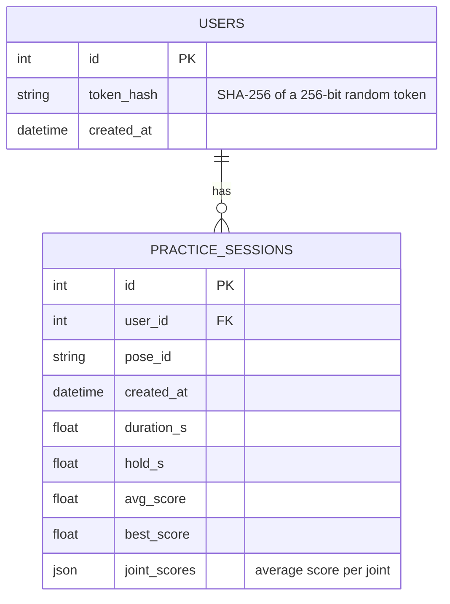
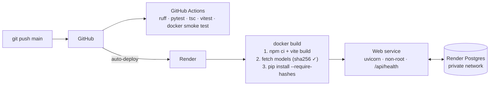

<div align="center">


# Prana

**A real-time AI yoga coach that runs entirely in your browser.**

Prana watches your form through your camera, measures every joint in 3D, scores your alignment live and *talks* you into the right shape. The video never leaves your device.

[](https://github.com/anay15/Prana/actions/workflows/ci.yml)


### [▶ Try it live: prana-yjwl.onrender.com](https://prana-yjwl.onrender.com)

<sub>Hosted on Render's free tier: the first visit after a quiet spell can take ~50 s to wake up.</sub>

[**Deploy your own**](#-deployment) · [Architecture](#-architecture) · [How the AI works](#-how-the-ai-works) · [Run locally](#-run-locally)



</div>

---

## ✨ Features

| | |
|---|---|
| 🧍 **3D pose tracking** | 33 body landmarks per frame from Google's BlazePose GHUM model, running on your GPU via WebGL2 (CPU/WASM fallback). |
| 📐 **Joint-by-joint scoring** | Elbows, shoulders, hips and knees are compared to reference angles with per-joint tolerance bands and weights. |
| 🔁 **Either-side detection** | Asymmetric poses (Tree, Warrior II, Triangle) are scored in both orientations, so you can practise on whichever side you like. |
| 🗣️ **Spoken coaching** | Short, specific corrections ("Straighten your left leg") through the browser's speech engine, throttled so it never nags. |
| ⏱️ **Hold timer** | A pose only counts while you're in good alignment. Hold it for the target time to complete it. |
| 📊 **Progress tracking** | Streaks, a 14-day activity chart, best score per pose and session history, all stored anonymously. |
| 🔒 **Private by design** | Inference is 100% on-device. No accounts, no uploads. One click deletes everything the server knows about you. |
| 📱 **Mobile-first, responsive** | Works on phones, tablets and laptops, with a bottom tab bar on mobile and a screen wake lock during practice. |

<table>
  <tr>
    <td width="68%"></td>
    <td></td>
  </tr>
  <tr>
    <td></td>
    <td></td>
  </tr>
</table>

---

## 🏗️ Architecture

Prana ships as **one container** with three parts: a React single-page app, the ML model files it runs in the browser, and a FastAPI service backed by Postgres. Serving all of it from a single origin keeps cookies first-party, makes the CSP strict (`connect-src 'self'`), and needs no CORS at all.



### What runs where

| Concern | Where | Why |
|---|---|---|
| Pose inference | Browser (GPU/WASM) | Real-time latency (~30 fps), privacy, zero inference cost |
| Scoring, cues, voice | Browser | Must react every frame; no round trip |
| Pose library (targets, cues) | API → `GET /api/poses` | Single source of truth, editable without a frontend release |
| History, stats, streaks | API + Postgres | Survives browser restarts and redeploys; anonymous identity |
| Model weights + WASM | Same origin, immutable cache | Self-hosted, SHA-256 pinned, no third-party CDN at runtime |

---

## 🔄 A practice session, end to end



---

## 🧠 How the AI works

### Model choice: why MediaPipe Pose Landmarker

Prana runs Google's **MediaPipe Pose Landmarker** (BlazePose GHUM) directly in the browser. It's the state of the art for **real-time, on-device** body tracking, and here is how it compares with the usual alternatives:

| | MediaPipe Pose Landmarker ✅ | YOLO-Pose | ViTPose / RTMPose (server) | MoveNet |
|---|---|---|---|---|
| Keypoints | **33, incl. feet & hands** | 17 (COCO) | 17 (COCO) | 17 |
| 3D world coordinates | **Yes (metres, hip-centred)** | No | No | No |
| Runs in the browser at 30 fps | **Yes (WebGL2 / WASM)** | Possible via ONNX, heavier | No, needs a GPU server | Yes |
| Video leaves the device | **No** | No | Yes | — |
| Licence | **Apache-2.0** | AGPL-3.0 (Ultralytics) | Apache-2.0 | Apache-2.0 |

**3D world landmarks are the key upgrade.** A knee bent at 90° looks like 60° or 120° in 2D depending on where the camera is. Measuring angles in 3D makes the score largely **independent of camera angle**, which matters when a phone is propped on the floor.

Two model sizes are bundled. `full` (9.4 MB) is the default on phones, and `heavy` (30.7 MB) on laptops/desktops with 8+ cores. Users can toggle "high accuracy mode" on the practice screen. On an Apple M2 the heavy model runs at **~26–30 fps** on the GPU delegate.

### From pixels to feedback



**Scoring formula.** For each target joint *j* with reference angle θ*ⱼ*, tolerance τ*ⱼ* and weight *wⱼ*:

```
error_j  = | θ_j − θ*_j |
score_j  = 100                                  if error_j ≤ τ_j
         = max(0, 100 − (error_j − τ_j) · 2.5)  otherwise        (0 at τ + 40°)
pose     = Σ w_j · score_j / Σ w_j   (over visible joints)
coverage = Σ w_j (visible) / Σ w_j (all)
```

Joints that matter most for a pose carry more weight (e.g. the standing knee in Tree Pose has weight 2.0, the elbows 0.5). The cue generator picks the lowest-scoring joint and turns the sign of its error into an instruction: knee too closed → *"straighten"*, shoulder too closed → *"raise your arm"*, hip too open → *"fold deeper"*.

### Supported poses

| Pose | Sanskrit | Level | Camera | Either side |
|---|---|---|---|---|
| Mountain | Tadasana | Beginner | Front | — |
| Tree | Vrksasana | Intermediate | Front | ✅ |
| Chair | Utkatasana | Beginner | Side | — |
| Warrior II | Virabhadrasana II | Intermediate | Front | ✅ |
| Triangle | Trikonasana | Intermediate | Front | ✅ |
| Downward Dog | Adho Mukha Svanasana | Beginner | Side | — |
| Plank | Phalakasana | Beginner | Side | — |
| Child's Pose | Balasana | Beginner | Side | — |

---

## 🧰 Tech stack

| Layer | Technology |
|---|---|
| **ML** | MediaPipe Tasks Vision `1.1.0`, Pose Landmarker (BlazePose GHUM full + heavy, float16), WebGL2 GPU delegate, WASM SIMD fallback |
| **Frontend** | React 19, TypeScript, Vite 8, Tailwind CSS v4, React Router 7, Lucide icons, Web Speech API, Screen Wake Lock API |
| **Backend** | Python 3.12, FastAPI, Pydantic v2, SQLAlchemy 2, Uvicorn, SlowAPI (rate limiting) |
| **Database** | PostgreSQL (production) · SQLite (local dev / fallback) |
| **Testing** | Pytest (API, security, validation, rate limits) · Vitest (geometry & scoring) · Docker smoke test |
| **Quality** | Ruff (lint + format), strict TypeScript, hash-pinned Python deps, npm lockfile |
| **Infra** | Multi-stage Docker image, Render Blueprint (web service + managed Postgres), GitHub Actions CI |

---

## 🗄️ Data model

Only **summaries** are stored, never images, video or landmarks.



---

## 🔐 Security & privacy

- **On-device inference.** Camera frames are processed in the browser and are never sent anywhere.
- **Anonymous identity.** The first save issues a 256-bit random token in an `HttpOnly`, `Secure`, `SameSite=Lax` cookie scoped to `/api`. The server stores only its SHA-256 hash, and every query is scoped to the caller's user id.
- **CSRF.** State-changing requests must carry an allow-listed `Origin` and a JSON content type (which forces a CORS preflight cross-site).
- **Strict input validation.** Pydantic schemas with `extra="forbid"`, numeric ranges, a known-pose allow-list and cross-field checks. Validation errors never echo submitted values.
- **Rate limiting.** Per-IP *and* per-identity limits (SlowAPI). Client IPs are taken only from proxy-appended `X-Forwarded-For` entries, so a spoofed header can't dodge the limit. Point `RATE_LIMIT_STORAGE_URI` at Redis when running more than one instance.
- **Security headers.** A strict CSP (`script-src 'self' 'wasm-unsafe-eval'`, `connect-src 'self'`, `frame-ancestors 'none'`), HSTS, `nosniff`, `X-Frame-Options: DENY`, and a `Permissions-Policy` that allows the camera for this origin only.
- **Supply chain.** Model files are downloaded from a pinned version and **SHA-256 verified** at build. Python dependencies are installed with `--require-hashes`.
- **Least privilege.** The container runs as a non-root user, and the database accepts private-network connections only.
- **Right to be forgotten.** `DELETE /api/sessions` (the "Delete my data" button) removes the user, their sessions and the cookie.

---

## 📁 Project structure

```
prana/
├── backend/
│   ├── app/
│   │   ├── main.py          # FastAPI app, error handlers, SPA static serving
│   │   ├── api.py           # /api routes: poses, sessions, stats
│   │   ├── poses.py         # Pose library: target angles, cues, illustrations
│   │   ├── security.py      # Identity cookie, CSRF, headers, rate limits
│   │   ├── schemas.py       # Pydantic request/response models
│   │   ├── models.py        # SQLAlchemy tables
│   │   ├── db.py · config.py
│   ├── tests/               # Pytest suite
│   └── requirements*.txt    # Hash-pinned dependencies
├── frontend/
│   ├── src/
│   │   ├── lib/
│   │   │   ├── pose-engine.ts   # Loads MediaPipe (GPU → CPU fallback)
│   │   │   ├── geometry.ts      # 3D angles, scoring, mirroring, cues (+ tests)
│   │   │   ├── voice.ts         # Throttled speech coach
│   │   │   └── api.ts           # Typed API client
│   │   ├── pages/           # Home, Library, Practice, Progress
│   │   └── components/      # Layout, PoseFigure, ScoreRing, …
│   └── scripts/fetch-models.mjs # Pinned, checksum-verified model download
├── Dockerfile               # Multi-stage: Node build → slim Python runtime
├── render.yaml              # One-click Render Blueprint
└── .github/workflows/ci.yml
```

---

## 💻 Run locally

**Prerequisites:** Python 3.12+, Node 20.19+ (or 22.12+).

```bash
# 1. Backend
cd backend
python3.12 -m venv .venv && source .venv/bin/activate
pip install --require-hashes -r requirements.txt
uvicorn app.main:app --reload --port 8000
```

```bash
# 2. Frontend (in another terminal)
cd frontend
npm ci
npm run fetch-models   # downloads + verifies the pose models (~40 MB, once)
npm run dev            # http://localhost:5173 (proxies /api to :8000)
```

> Camera access needs a secure context: `localhost` works, and so does any HTTPS URL. To test on your phone over Wi-Fi, use the deployed URL or an HTTPS tunnel.

**Or run the production image with Docker:**

```bash
docker build -t prana .
docker run -p 8000:8000 -e APP_ENV=development prana   # http://localhost:8000
```

### Tests

```bash
cd backend && pip install --no-deps -r requirements-dev.txt && pytest && ruff check .
cd frontend && npm test && npm run typecheck
```

---

## 🚀 Deployment

Prana deploys to **[Render](https://render.com)** from the included Blueprint. It creates a Docker web service and a managed Postgres database, wired together automatically.

[](https://render.com/deploy?repo=https://github.com/anay15/Prana)



1. Fork or clone this repo to your GitHub account.
2. In Render, choose **New → Blueprint** and select the repo. Render reads `render.yaml`.
3. Click **Apply**. The first build takes about 5 minutes. Render injects `DATABASE_URL` and `RENDER_EXTERNAL_URL`, and the app uses the latter as its allowed origin.

| Variable | Default | Purpose |
|---|---|---|
| `DATABASE_URL` | `sqlite:///./prana.db` | Postgres connection string (set by the Blueprint) |
| `APP_ENV` | `development` | `production` enables `Secure` cookies and HSTS |
| `ALLOWED_ORIGINS` | `RENDER_EXTERNAL_URL` | Extra comma-separated origins, e.g. a custom domain |
| `RATE_LIMIT_STORAGE_URI` | `memory://` | e.g. `redis://…` for multi-instance rate limiting |
| `TRUSTED_PROXY_HOPS` | `0` (`3` on Render) | Proxies that append to `X-Forwarded-For`; only those entries are trusted for client IPs |

> **Free-tier notes.** Render's free web services sleep after 15 minutes of inactivity, so the first request after that takes around a minute. Free Postgres databases expire after 30 days. For a long-lived demo, upgrade the database, or point `DATABASE_URL` at any Postgres provider (e.g. Neon or Supabase). The practice experience itself never depends on the backend being awake once the page has loaded.

---

## 📡 API

Interactive docs at **`/api/docs`** (OpenAPI).

| Method | Path | Description |
|---|---|---|
| `GET` | `/api/health` | Liveness probe |
| `GET` | `/api/poses` | Pose library with targets, cues and illustrations |
| `POST` | `/api/sessions` | Save a practice summary (creates the anonymous identity on first call) |
| `GET` | `/api/sessions?limit=50` | Caller's recent sessions |
| `GET` | `/api/stats?tz_offset=330` | Totals, streak, 14-day minutes, best per pose |
| `DELETE` | `/api/sessions` | Delete all of the caller's data |

---

## ➕ Adding a pose

1. Add an entry to `POSES` in [`backend/app/poses.py`](backend/app/poses.py) with target angles (interior 3D angles, 0–180°), tolerances, weights, cues and a stick-figure `figure`.
2. Set `mirror: true` if the pose can be done on either side.
3. Run `pytest`. The suite checks that every target references a known joint and a valid angle.

No frontend change is needed: the UI, scoring and illustrations are all data-driven.

---

## 🗺️ Roadmap

- [ ] Guided flows (sequences of poses with transitions)
- [ ] Breath pacing with an audio metronome
- [ ] Per-user calibration for limited mobility
- [ ] Installable PWA with offline practice
- [ ] Optional sign-in to sync progress across devices

---

## 🙏 Acknowledgements

- [MediaPipe](https://ai.google.dev/edge/mediapipe/solutions/vision/pose_landmarker) by Google (Apache-2.0) for the Pose Landmarker models and runtime.

## 📄 License

[MIT](LICENSE) © 2026 Anay Nayak
